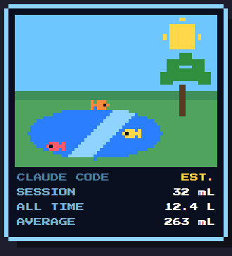
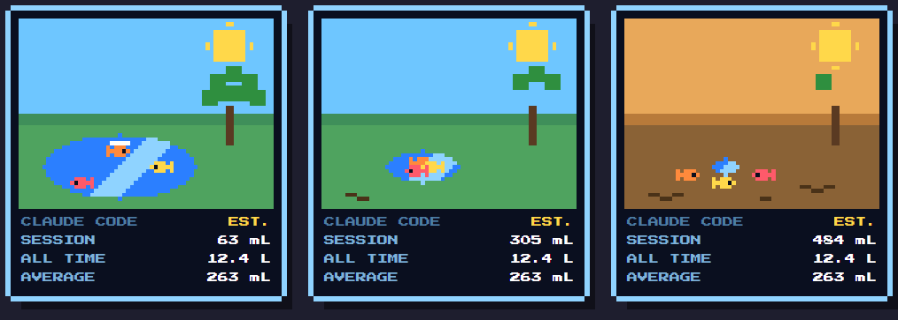
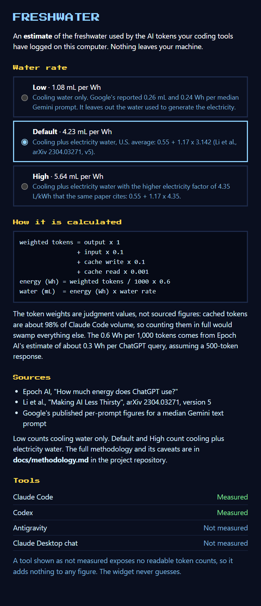

# Freshwater

**[unforgbeast.github.io/codegreen](https://unforgbeast.github.io/codegreen/)**

A small floating 8-bit widget that makes the cost of AI coding visible. It reads the token counts your coding tools already log on this computer and shows an **estimate** of the freshwater used: this session, all time, and on average. A pixel lake dries up as a session uses tokens, and the fish crowd together and flop on the mud. They never die. The point is to feel responsible for the next prompt, not to feel bad.

The widget stays on top of your other windows, can be dragged anywhere, and remembers where you left it.

<p align="center"></p>

## What it looks like

The lake compares a session against your own average. Early on the fish swim and jump, in the middle the water pulls back and the sky turns hazy, and under heavy use the fish are stranded and flop on the mud. They never die. The figures shown here are made-up samples.

<p align="center"></p>

Click the figures for the info panel, with the water rate presets, the formula, the sources and each tool's status:

<p align="center"></p>

## Install

You need Node.js 22 or newer. Windows, macOS and Linux are supported.

```
npm install
npm start
```

**Downloads:** installers will be on the [Releases page](https://github.com/UnforGBeast/codegreen/releases). Releases are published only from signed builds, so if a release is not there yet, that is why. Maintainers: see [docs/releasing.md](docs/releasing.md).

To build an installer for the system you are on, run `npm run dist` (Windows), `npm run dist:mac` (macOS) or `npm run dist:linux` (Linux). The result is written to `dist/`.

Platform notes:

- **Windows** is the most tested platform.
- **macOS** hides the Dock icon and floats the widget over fullscreen apps. The build is unsigned, so macOS will ask you to allow it.
- **Linux** needs a compositor for the transparent window. "Start at login" is not offered because Electron cannot set it there.
- Not yet checked by eye on macOS and Linux: dragging, and the right-click menu on the lake picture.

Right-click the widget for Info, Start at login (installed Windows and macOS builds only), and Quit. Click the figures to open the info panel.

## What is measured

| Tool | Source | Status |
|---|---|---|
| Claude Code (CLI and VS Code extension) | `~/.claude/projects/**/*.jsonl` | Measured |
| Codex | `~/.codex/sessions/**/*.jsonl` | Measured, for sessions that log an input and output split |
| Gemini CLI | `~/.gemini/tmp/<project>/chats/**/*.jsonl` (honours `GEMINI_CLI_HOME`) | Measured. Built from the CLI's own source and test fixtures, but not yet checked against a real install; sessions saved in the old single-file `.json` format are not read |
| Antigravity | `~/.gemini/antigravity/` | Not measured: no readable token counts |
| Claude Desktop chat | none found | Not measured: no local logs |

A tool shown as **not measured** adds nothing to any figure. The widget never guesses. If a log format changes and cannot be parsed, that tool is shown as not measured too.

## The figure is an estimate

```
weighted tokens = output x 1 + input x 0.1 + cache write x 0.1 + cache read x 0.001
energy (Wh)     = weighted tokens / 1000 x 0.6
water (mL)      = energy (Wh) x water rate (mL per Wh)
```

- The token weights are judgment calls, not sourced figures. Cached tokens are about 98% of Claude Code volume, so counting them in full would swamp everything else.
- 0.6 Wh per 1,000 tokens comes from Epoch AI's estimate of about 0.3 Wh per ChatGPT query, which assumes a 500-token response.
- The water rate has three presets, chosen in the info panel. They follow the formula in Li et al. (arXiv 2304.03271 v5), water = energy x [cooling water + PUE x electricity water]. **Low** is 1.08 mL per Wh: cooling water only, from Google's per-prompt figures. **Default** is 4.23 mL per Wh: cooling plus electricity water, the U.S. average in the paper. **High** is 5.64 mL per Wh: the same, with the higher electricity factor the paper cites.

This is a rough, order-of-magnitude figure, and the uncertainty runs in both directions. [docs/methodology.md](docs/methodology.md) has the sources, a worked example, what could be wrong and what is left out.

The lake level compares a session against your own average: an average session leaves the lake half gone. Until you have 5 sessions it uses a baseline of 146 Wh per session (the mean of the author's own logs), so the lake looks the same whichever rate you choose.

## Privacy

By default nothing leaves your computer. The widget has no accounts or telemetry, bundles its font, and makes **no network requests** except one you can choose to allow: an update check that asks GitHub whether a newer release exists. It is **off by default**; in an installed copy, right-click the widget to check now or to switch on automatic checks. It reads only usage numbers and timestamps from the logs and never stores or shows conversation text. Per-session totals are kept in `~/.freshwater/ledger.json` so that all-time figures survive tools deleting old logs. Settings are in `~/.freshwater/settings.json`.

The widget never limits or blocks token use.

## Development

```
npm test
```

The calculation and log parsing live in `src/core` and `src/adapters` and are tested with plain Node, with no Electron needed. Fixtures contain no real conversation text. To add a tool, follow [the adapter guide](CONTRIBUTING.md#adding-a-tool).

The Press Start 2P font is bundled under the SIL Open Font License; see `src/renderer/FONT-LICENSE.txt`.

## Contributing

Contributions are welcome, and many need no code: checking the widget on your system, or finding out what another tool logs, helps just as much. Start with [CONTRIBUTING.md](CONTRIBUTING.md). Please also read the [code of conduct](CODE_OF_CONDUCT.md), and report security problems as described in [SECURITY.md](SECURITY.md).

## License

MIT, see [LICENSE](LICENSE).
